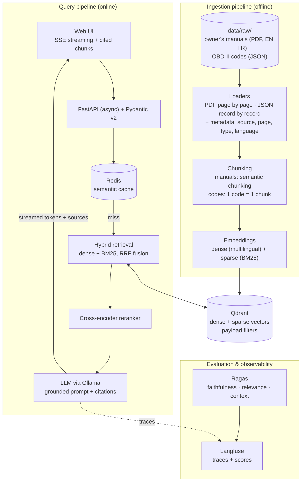

# Vehicle Diagnostics & Maintenance Assistant (Advanced RAG)

A bilingual (English / French) assistant that answers vehicle owners' and mechanics' questions from **official vehicle documentation**: owner's manuals and the standard OBD-II diagnostic trouble codes. Every answer cites its source, and the assistant **refuses to answer** when the documentation doesn't cover the question. It runs locally on open-source components: no data leaves the machine.

---

## 1. Product vision

### Who it is for

| User | Their question |
|---|---|
| **Vehicle owners** | *"The engine light is on and my scanner shows P0420. What does it mean?"* |
| **Do-it-yourself mechanics** | *"How do I check the engine oil level, and how much oil does the engine take?"* |
| **Garage technicians and service advisors** | *"What is the recommended tire rotation interval?"* |
| **French-speaking drivers** | *"Que signifie le témoin de la batterie ?"*, answered in French even when the source page is in English |

### The problem

- An owner's manual runs to **600+ pages**. The answer to a simple question is buried in tables, cross-references and warnings.
- Diagnostic trouble codes such as **P0420** or **P0171** are cryptic. Their meaning lives in a separate reference list that owners don't have.
- Manuals exist in several languages, but the one in hand may not be the reader's language.
- General-purpose chatbots **invent** maintenance intervals, fluid capacities and code meanings. A wrong torque value or a misread warning can damage the vehicle or put the driver at risk.

### Why RAG is the right approach

| Requirement | Why a plain LLM fails | What RAG provides |
|---|---|---|
| Answers specific to *this* vehicle's documentation | The LLM answers from generic, mixed-model knowledge | Retrieves the exact manual passage |
| Exact identifiers (P0420 vs P0455) | Embedding models see diagnostic codes as near-identical | **Hybrid search**: BM25 matches codes exactly |
| Verifiable answers | An LLM can't point to a page | **Inline citations** with file and page |
| Wrong answers cause harm | LLMs answer confidently anyway | **Grounded prompt + refusal** when the documents don't cover it |
| English and French users and sources | — | **Multilingual retrieval and answers** |

### Scope

- **In scope:** the vehicle's owner's manuals (EN + FR) and the generic OBD-II powertrain codes (SAE J2012).
- **Out of scope:** repair procedures not in the manuals, other vehicle models, and diagnosis beyond what the code definition states.

---

## 2. Features

### Must have

- **Validated ingestion and semantic chunking.** Manuals are split where the meaning changes; each diagnostic code stays one atomic chunk.
- **Hybrid retrieval (dense + sparse) with a reranker.** Dense multilingual embeddings and BM25 are fused with Reciprocal Rank Fusion, then a cross-encoder reranks the candidates.
- **Async FastAPI API with Pydantic v2** request and response models.
- **Web UI with SSE streaming**: the answer streams token by token, with the cited chunks shown alongside.
- **Automated CI/CD**: GitHub Actions runs the linter (ruff) and the test suite on every push and pull request.

### Should have

- **Continuous evaluation (MLOps)**: Ragas metrics (faithfulness, answer relevance, context precision) logged to Langfuse.
- **Redis semantic cache** for frequent questions, guarded so that two different diagnostic codes never share a cached answer.

### Safety

- **Refusal by design** when the documentation doesn't contain the answer.
- **Prompt-injection guardrails**: system-role isolation and fencing of untrusted text.

---

## 3. Architecture (initial)



**Ingestion.** PDFs are read page by page and the code list record by record. Each piece is tagged with its source, page, document type and language. Manual text goes through semantic chunking, and each diagnostic code stays one chunk. Every chunk is stored in Qdrant with a dense multilingual vector and a sparse BM25 vector.

**Query.** The API checks the Redis cache; on a miss, Qdrant runs hybrid search (dense + BM25 fused by RRF, with optional metadata filters such as language). A cross-encoder reranks the candidates, the best chunks go into a grounded prompt, and the LLM's answer streams to the UI over Server-Sent Events with its sources.

**Evaluation.** A bilingual evaluation set (code lookups, maintenance intervals, procedures, out-of-scope questions) is scored with Ragas, and the scores and traces are logged to Langfuse.

---

## 4. Technology stack

| Layer | Choice |
|---|---|
| API | **FastAPI** (async) + **Pydantic v2** |
| Orchestration | **LangChain** |
| Vector database | **Qdrant** (see [section 5](#5-vector-database-choice)) |
| Dense embeddings | multilingual sentence-transformer (English / French) |
| Sparse retrieval | BM25 (FastEmbed `Qdrant/bm25`) |
| Reranker | multilingual cross-encoder |
| LLM | open-source model served locally by **Ollama** |
| Cache | **Redis** Stack (vector search for the semantic cache) |
| Evaluation | **Ragas** |
| Observability | **Langfuse** |
| UI | web front end consuming **SSE** |
| CI/CD | **GitHub Actions**: ruff + pytest |
| Local environment | **Docker Compose** |

---

## 5. Vector database choice

Qdrant, Milvus and pgvector were compared on **metadata filtering**, **latency**, **local orchestration simplicity** and **native hybrid search**. The full argued specification is in [`docs/vector-database-choice.md`](docs/vector-database-choice.md).

| Criterion | Qdrant | Milvus | pgvector |
|---|---|---|---|
| Metadata filtering | ✅ payload filters applied during the search, with indexes | ✅ boolean scalar filters | ✅ full SQL `WHERE` |
| Native hybrid search (dense + sparse) | ✅ one query, RRF fusion | ✅ recent versions | ⚠️ no native BM25 |
| Latency | low (Rust, HNSW) | low, built for very large scale | good at small/medium scale |
| Local orchestration | ✅ **1 container** | ❌ **3 services** (Milvus + etcd + MinIO) | ✅ 1 container + extension setup |

**Decision: Qdrant.** Hybrid search is the core requirement, because diagnostic codes need exact matching. Qdrant does it natively in a single query, filters by metadata during the search, and runs as a single container.

---

## 6. Data corpus (validated)

| File | Format | Content | Language | Size |
|---|---|---|---|---|
| `data/raw/manuals/2017-F-150-Owners-Manual-English.pdf` | PDF | Ford F-150 2017 owner's manual | English | 599 pages |
| `data/raw/manuals/2017-F-150-Owners-Manual-French.pdf` | PDF | Ford F-150 2017 owner's manual | French | 683 pages |
| `data/raw/obd_codes.json` | JSON | Generic OBD-II powertrain diagnostic trouble codes (SAE J2012) | English | 469 codes |

**Validation.** `scripts/validate_corpus.py` checks every file:
- PDFs open and have extractable text, not scanned images;
- each manual's text is in its expected language;
- every code matches the SAE format (P + 4 characters);
- there are no duplicate codes and no empty descriptions.

It writes `data/raw/manifest.json` with page counts, sizes and SHA-256 checksums. **Current result: all checks pass.** Two typos in the source code list were found and corrected (details in [`data/raw/README.md`](data/raw/README.md)).

```bash
pip install pypdf
python scripts/validate_corpus.py
```

### Planned chunking strategy

| Content | Strategy | Why |
|---|---|---|
| Owner's manuals | **Semantic chunking**: split where the meaning changes, based on embedding similarity between sentences | Keeps a procedure, its steps and its warnings together |
| Diagnostic codes | **1 code = 1 chunk** | The code must never be separated from its meaning |

Every chunk carries metadata (`source`, `page`, `doc_type`, `language`, `chunk_id`) for citations and filtering.

---

## 7. Local environment (Docker)

```bash
docker compose up -d                   # Qdrant vector database
docker compose --profile cache up -d   # + Redis semantic cache
docker compose down                    # stop (data stays in Docker volumes)
```

| Service | Image | Address | Role |
|---|---|---|---|
| `qdrant` | `qdrant/qdrant:v1.20.0` | http://localhost:6333 (dashboard: `/dashboard`), gRPC 6334 | Vector database |
| `redis` *(profile `cache`)* | `redis/redis-stack-server:7.4.0-v3` | localhost:6379 | Semantic cache |

Ports are bound to `127.0.0.1` only, and data persists in named Docker volumes.

---

## 8. Repository structure

```
.
├── README.md
├── docker-compose.yml              Qdrant (+ Redis, profile "cache")
├── docs/
│   └── vector-database-choice.md   argued vector database specification
├── data/
│   └── raw/
│       ├── README.md               data card: sources, validation, corrections
│       ├── manifest.json           validated file list with checksums
│       ├── obd_codes.json          469 OBD-II codes
│       └── manuals/                owner's manuals (PDF, EN + FR)
└── scripts/
    └── validate_corpus.py          corpus validation
```

---

## 9. Roadmap

- [x] Validated ingestion corpus in `data/raw/`
- [x] Product vision and initial architecture
- [x] Argued vector database choice
- [x] Docker Compose environment (Qdrant + Redis)
- [ ] Ingestion: loaders, semantic chunking, dense + sparse embeddings into Qdrant
- [ ] Hybrid retrieval + cross-encoder reranker
- [ ] Async FastAPI API (Pydantic v2) with SSE streaming
- [ ] Web UI with streamed answers and cited chunks
- [ ] CI/CD: GitHub Actions (ruff + pytest)
- [ ] Ragas evaluation logged to Langfuse
- [ ] Redis semantic cache

---

## Data attribution

The Ford F-150 owner's manuals are © Ford Motor Company and are included for academic, non-commercial use. The OBD-II code list contains the generic SAE J2012 powertrain codes, compiled from the open-source [dtcdb](https://github.com/todrobbins/dtcdb) project.
